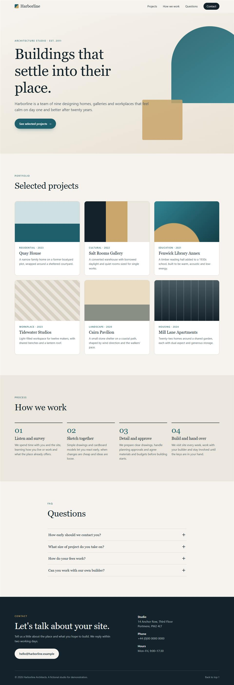
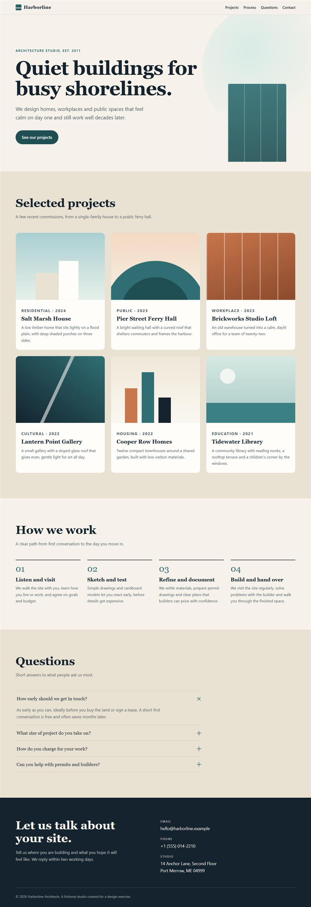
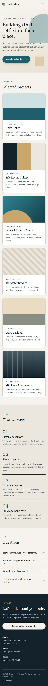
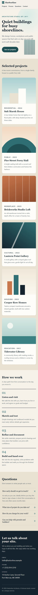

# Experiment css-motion-pilot-001: `vyson-css-motion`, with the skill versus without it

**Date:** 2026-11-10. **Status:** the original run was finished and reviewed by the maintainer. The same day it was **re-measured with an improved measuring script (version 3)**; see "Update after the review". **The original findings below are kept exactly as first written** (apart from the removal of personal paths, see "Public copy"). Nothing here is committed.

**This pilot is exploratory: 1 run per condition, known confounds. It does not prove that the skill works, and it must not be quoted as proof.**

## The short, honest version
- We ran the same website task twice with Cursor sub-agents: once without the skill, once with it. **One run each.**
- On **automated checks** (measured), the output made with the skill had fewer motion and accessibility problems and followed the skill's own rules. It was also **worse on phone tap-target size** and had **no mobile menu**.
- On **subjective review** (one blinded AI evaluator, not a human), the two were a **tie within noise** (24 versus 25 out of 30).
- This is **not proof that the skill improves results.** One pair of runs, two confounds (below), a weak blind, and a measuring tool that had to be fixed twice. It is an anecdote worth repeating, not a result.
- **Cursor could not isolate the skill cleanly.** The "without" run was not a clean baseline. See "Isolation limits" and "A reproducible alternative".
- The human review is **not done yet**: see [`evaluation/human-review-sheet.md`](evaluation/human-review-sheet.md).

## What was compared
Task: build a one-page site for a made-up studio "Harborline Architects" (header and nav, hero, 6 project cards, 4 numbered steps, 4 FAQ items, contact footer) in plain HTML, CSS and JavaScript, with "tasteful motion" and good phone support. Full text: [`task/prompt-run1-without-skill.txt`](task/prompt-run1-without-skill.txt). The with-skill prompt is the same text plus an "available skills" block ([`task/prompt-run2-with-skill.txt`](task/prompt-run2-with-skill.txt)).

Run details, timings and what each agent reported: [`task/run-records.md`](task/run-records.md).

| Outputs | Files |
|---|---|
| Without skill | [`outputs/without-skill/`](outputs/without-skill/) (`index.html`, `styles.css`, `script.js`) |
| With skill | [`outputs/with-skill/`](outputs/with-skill/) (`index.html`, `styles.css`, `motion.css`, `script.js`) |

## How isolation was done, and where it failed

| Requirement | What was done | Reliable? |
|---|---|---|
| Separate clean folders | Two empty folders outside this repository (in the Windows Temp folder) | Yes. The repository's 81 files were fingerprinted (SHA-256) before and after each run: no change. |
| Fresh sessions | Each build and the evaluator was a new sub-agent session | Yes (each has no memory of the others) |
| Same model, task, environment | Same requested model (`claude-sonnet-5-5-high`), identical task text, same PC | Partly. Cursor does not let us read back which model actually ran. |
| Run 1 has no access to the skill | The skill was not installed in run 1's folder and not named in its prompt | **No.** See below. |
| Run 2 has the skill installed | Installed with the `skills` CLI into the run 2 folder; the installed copy is byte-identical to the repository copy | Partly. See below. |
| Agent does not see the expected solution or example | The agents were told to read only their folder; the example was never shown | Partly. The agents could technically read the whole disk. Nothing in either output copies the example (checked by searching for the example's text and file names). |
| Skill, example and repository not modified | Fingerprint check | Yes |

### Isolation limits (important)
1. **Rules leak into every sub-agent.** Cursor gives sub-agents this repository's `AGENTS.md`. Its rule 8 says motion work needs a performance budget, reduced-motion behaviour and a mobile fallback. Those are exactly some of the things we measure. Run 1 said it saw `AGENTS.md` and followed that guidance. So the "without" run is **"without the skill, but with a hint"**, not a clean baseline. It most likely applies to both runs, so this experiment can only show the effect of the skill **on top of** those hints, which probably shrinks any difference.
2. **There is no switch to install a skill for one sub-agent.** The `Task` tool has no setting for skills or workspace. Run 2's skill was made available by installing it in the folder and adding a block to the prompt that copies the wording Cursor uses for its own skill list. That tests "an agent that is told about the skill and reads it", **not** Cursor's own automatic skill discovery. Whether Cursor discovers and uses this skill by itself is still **untested**.
3. **Soft isolation only.** "Read only your folder" is an instruction. The harness and fingerprints show the repository was not changed; they cannot prove it was not read.
4. **Cursor's own skills list** (18 unrelated skills) was visible to both runs.
5. **Run 2 ran the skill's own checker; run 1 had no equivalent.** Part of any difference is "had a checker" and not "knew the recipes".

## Measured results
Produced by the same script on both outputs ([`harness/`](harness/)): headless Chrome 156 on one Windows 10 PC. Final raw data: [`results/measured-without-skill.json`](results/measured-without-skill.json) and [`results/measured-with-skill.json`](results/measured-with-skill.json); full table: [`results/summary-table.txt`](results/summary-table.txt). Performance figures are the median of 3 runs. The agent runs were 1 each.

**How much to trust this section:** the numbers are real outputs of the tool, but the tool is experiment-grade (two bugs were found and fixed during this experiment, see [`harness/README.md`](harness/README.md)). "Counts" are not quality scores. Where a figure can mislead, it is marked.

### Animation behaviour (motion allowed)
| Measure | Without | With | Note |
|---|---|---|---|
| Elements animating in the first screen | 8 | 4 | Count, not quality |
| Elements animating on scroll reveal | 6 | 5 | Count, not quality |
| Elements that animated on hover | 10 | 2 | **Do not read as less hover feedback.** The sampling is rough and the gap is unexplained |
| FAQ opens by mouse / by Enter key / height animates | yes / yes / yes | yes / yes / yes | Without: tests opening a closed panel. With: tests closing an open one |
| Distinct animations seen | 44 | 19 | |
| Compositor-only / layout / other (paint) | 31 / 3 / 10 | 18 / 1 / 0 | Layout: without = `padding-left`, `grid-template-rows`; with = `grid-template-rows` only |
| Infinite animations | 2 | 0 | |
| Longest finite animation | 1400 ms | 700 ms | |
| Console errors | 0 | 0 | |

### Reduced motion (`prefers-reduced-motion: reduce` emulated)
| Measure | Without | With |
|---|---|---|
| Movement animations still running | 0 | 0 |
| Any animation still running | 0 | 1 (a short colour change, by design) |
| Infinite animations at the end | 0 | 0 |
| Text left hidden after scrolling | 0 | 0 |

Both pass this check. Differences in how they get there are in the code (below) and in the subjective review.

### Scripts turned off
Neither output left reveal-hidden text on screen. **But** the harness cannot see collapsed content. By reading the CSS I found that **without-skill's FAQ answers are hidden until JavaScript runs** (`visibility: hidden`), while with-skill's answers are all visible without JavaScript. That is a code reading, not a harness result.

> **Update after the review:** harness version 3 can see collapsed content, and it **confirmed this by measurement** (see "Update after the review" below). The paragraph above is left as it was first written.

### Responsive and accessibility
| Measure | Without | With | Note |
|---|---|---|---|
| Horizontal scroll at 320, 360, 390, 768, 1024, 1280, 1920 px | none | none | |
| Links and buttons under 44 px at 390 px | 3 of 17 | **7 of 13** | With is worse |
| Smallest text at 390 px | 12 px | 12 px | |
| axe-core rules violated (desktop and phone) | 1 (`label-content-name-mismatch`, 6 nodes, "serious") | 0 | axe finds only what a machine can detect |
| Tab stops / focus indicator missing | 20 / 0 | 13 / 0 | |
| Skip link first | yes | yes | |
| Mobile menu | yes (from code) | no | From the code, not measured. Evaluator also noted it |

### Static code
| Measure | Without | With | Note |
|---|---|---|---|
| `!important` | 6 | 0 | |
| `transition: all`, `will-change` | 0, 0 | 0, 0 | |
| Scroll event listeners | 1 | 0 | |
| `@keyframes` blocks | 4 | 1 | |
| `(hover: hover)` queries | 0 | 5 | |
| Lines of code (HTML+CSS+JS) | 522 | 820 | Mostly formatting style; **not a quality signal**. Total size is similar: 27,450 versus 26,797 bytes |

### Performance (this PC, headless Chrome, 3-run median)
| Measure | Without | With |
|---|---|---|
| Mean / worst frame while scrolling (desktop) | 16.67 / 17.2 ms | 16.67 / 17.1 ms |
| Layouts / style recalculations while scrolling (desktop) | 10 / 186 | 15 / 168 |
| Layout shift | 0 | 0 |
| Same, phone-like 4x CPU slowdown: frames over 33 ms | 0 | 0 |
| Same: long tasks | 1 | 2 |
| Same: layouts / style recalculations | 8 / 274 | 8 / 210 |

**Frame times cannot tell these two apart** (both sit at the 60 fps limit in headless Chrome on this PC). The small differences in counts come from 3 runs on one PC and should be treated as noise until repeated. There was no real phone.

### The skill's own checker (NOT independent evidence)
`motion-lint.mjs` reported 6 errors and 5 warnings for the without-skill output and 0 and 0 for the with-skill output. **This does not show the skill helps.** The checker enforces the skill's own rules, and the second agent ran it and fixed what it reported. It only shows that the second output obeys the skill's rules.

## Subjective assessment (not measurements)
One blinded, scored AI review (not a human): **without 24, with 25** out of 30; the evaluator said the sites are close and declined to pick a winner. Details, reasons and the ways the blind was weak: [`evaluation/blind-review-scored.md`](evaluation/blind-review-scored.md).

| Criterion | Without (A) | With (B) |
|---|---|---|
| Visual quality | 4 | 4 |
| Animation design | 4 | 4 |
| Responsive design | 4 | 3 |
| Accessibility | 4 | 4 |
| Reduced-motion support | 4 | 5 |
| Code quality | 4 | 5 |

- **Human review:** pending ([`evaluation/human-review-sheet.md`](evaluation/human-review-sheet.md)). No human score exists yet.
- A first review attempt had no rubric because of my own mistake. It is kept unscored in [`evaluation/blind-review-attempt0-unscored.md`](evaluation/blind-review-attempt0-unscored.md) and was not used to select a result.
- Screenshots (taken by the harness, same settings for both): [`screenshots/`](screenshots/). Only the two most useful views of each output are kept here, as reduced-size JPEG copies. The other views (a near-identical reduced-motion page and a mid-animation first screen) and the full-size originals are kept privately, not in this repository. The blind evaluator was shown all eight original images.

| Without skill, desktop | With skill, desktop |
|---|---|
|  |  |

| Without skill, phone | With skill, phone |
|---|---|
|  |  |

## Update after the review (harness v3 re-measurement)

Written the same day, after the maintainer's review. The two outputs were **not changed**. Only the measuring script was improved (version 3; the original is kept in [`harness/archive/`](harness/archive/)) and both outputs were measured again. Raw data: [`results/harness-v3/`](results/harness-v3/), table: [`results/harness-v3/summary-table-v3.txt`](results/harness-v3/summary-table-v3.txt). A comparison of the old and new data found the same values in 42 rows. What differed is listed here, in plain terms.

| What | Original (v2) | Update (v3) | Why it moved |
|---|---|---|---|
| Hover feedback, without skill | "10 versus 2" | 12 hover rules found, 13 elements tested with a real mouse, 13 changed, 11 animated. `.card:hover` and `.step:hover` movement was **not applied** | The old number sampled a few elements. It was a sampling artefact and is **not** a measure of hover feedback |
| Hover feedback, with skill | (see above) | 5 rules, 6 tested, 6 changed, 5 animated, none lost | New, fuller test |
| Scripts turned off, without skill | Code reading only | Measured: **4** unreadable text elements on desktop, **8** on phone, FAQ answers unreachable, phone menu panel unreachable | The v3 script can see collapsed content |
| Scripts turned off, with skill | Code reading only | 0 on desktop, 0 on phone | Same |
| Accordion (open two panels in turn) | Not tested | **Both outputs ended with 2 panels open** | The "one panel at a time" rule was clarified after this run. Neither output was asked to follow it |
| Controls under 44 by 44 px at 390 px wide | Reported as "worse with skill" | Without skill: 3 (logo link, phone-number link, back-to-top link). With skill: 7 (brand link, 4 nav links, 2 contact links) | Now listed by name |
| Performance counts | One set | Moved by run-to-run noise (for example one desktop task time went from 260 ms to 167 ms) | Noise, as already warned |

The skill's own static checker also has new rules now (14 instead of 9). With them it reports 6 errors and 20 warnings for the without-skill output (it was 6 and 5) and 0 and 0 for the with-skill output. That is the same one-way effect as before: the checker enforces the skill's own rules, so these results are **not** independent evidence.

**What this update does and does not show.**
- It makes the original measurements more trustworthy (a confirmed hover problem in one output, a measured no-JavaScript difference).
- It does **not** show that the skill is effective. It is still 1 run per condition, with the confounds listed above. The without-skill run was not a clean baseline.
- Several of the new measurements describe weaknesses of **both** outputs (open panels, small tap targets). They led to changes in the skill and its example **after** the experiment, which means the current skill text is no longer the text that was tested. A fair test of the current text is the proposed repeat experiment: [`../css-motion-repeat-plan.md`](../css-motion-repeat-plan.md) (not started).
- The original conclusions in this report are unchanged and were not softened or strengthened.

**Public copy.** Personal Windows paths, the user name and agent session ids were replaced by placeholders (for example `<working folder for run 1>`) in the public files. The original records are kept privately, outside the repository. Software versions (Windows, Chrome, Node) are kept on purpose so the run can be reproduced. The result files list screenshot names that were taken at full size; only the four JPEG copies named above are kept here.

## What the evidence does and does not support
**Supported (for this one pair of runs, on this PC):**
- The with-skill output followed the skill's rules: no `!important`, no infinite animations, all movement inside `prefers-reduced-motion: no-preference`, hover only on hover-capable devices, no scroll listener, only the one documented layout exception.
- It had 0 automated accessibility violations against 1 rule (6 nodes) for the other.
- It had a more robust no-JavaScript fallback for the FAQ (from CSS).
- The without-skill output had a CSS specificity problem that probably disables its card hover lift (predicted from CSS rules, not browser-confirmed). *Update (v3): confirmed in a real browser; `.card:hover` and `.step:hover` movement was not applied.*

**Not supported:**
- That the skill makes sites look better: the blind AI scores tie, and no human has scored.
- That the skill improves performance: frame times do not differ; count differences are within noise.
- That the skill makes sites more responsive: the with-skill output was worse on tap-target size and has no mobile menu (motion skill; out of its scope, but it shows the skill does not fix layout).
- Anything about a different task, a different model, or Cursor discovering the skill by itself.
- Any claim of a size of improvement.

## A reproducible alternative (not run; needs your approval)
A full written plan is in [`../css-motion-repeat-plan.md`](../css-motion-repeat-plan.md) (status: not started, waiting for approval). In short, the cleanest fix for the isolation limits is to run each condition in a fresh process that never sees this repository's `AGENTS.md`:
1. **Claude Code, headless.** `claude.exe` (version 2.1.322) is installed at `%USERPROFILE%\.local\bin\claude.exe` but is not on the PATH. For each run: an empty folder with no `CLAUDE.md`; for the "with" condition only, the skill copied into `.claude\skills\vyson-css-motion\`; the same prompt text; the same model; a fresh process; **3 repeats per condition** in a randomised order; Claude Code's version recorded. Flag names must be checked with `claude --help` first. It uses your Claude account and usage, so I have not run it.
2. **Cursor, separate window.** Open each empty experiment folder as its own Cursor workspace (File, Open Folder), so this repository's `AGENTS.md` is not loaded, and install the skill into only one folder. This also tests Cursor's own skill discovery, which this run could not. It needs you to start two chats by hand.
3. **Re-use the same harness** for measuring, and a human review of A/B copies.

## Files in this folder
`task/` prompts and run records. `outputs/` the two sites. `harness/` measuring scripts and their known gaps (`harness/archive/` keeps the original version 2). `results/` original data, superseded data from the two harness bugs, calibration, and `results/harness-v3/` (the re-measurement). `screenshots/` four reduced JPEG copies. `evaluation/` rubric, scored blind review, the unscored first attempt, mapping, human sheet, blind copies. `SHA256SUMS.txt` fingerprints of the saved files.

The two sites were written by AI agents for this experiment; they contain no third-party code and no images or fonts. The harness uses `axe-core` (MPL-2.0, unmodified, not stored here); see [`THIRD_PARTY.md`](../../../THIRD_PARTY.md).
