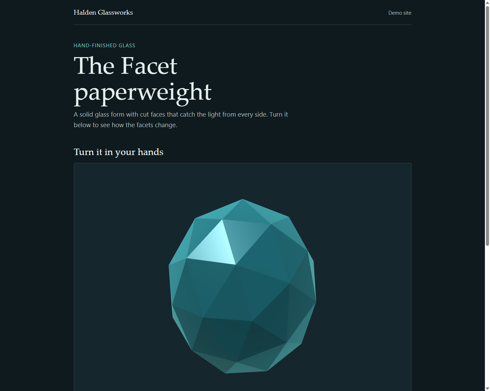

# Example: vyson-3d-interactive-web

A one-page product viewer for the Facet paperweight from Halden Glassworks, a made-up glass studio. It shows the method of the [`vyson-3d-interactive-web`](../../skills/vyson-3d-interactive-web/SKILL.md) skill: a page that works without 3D, a small plain-WebGL scene on top of it, and a fallback for every case where the scene should not run.



## Open it

Browsers do not load JavaScript modules from a page opened by double-clicking it (a `file://` address). Serve the folder with the small server in the skill, then open the address it prints:

```powershell
node skills/vyson-3d-interactive-web/scripts/serve.mjs examples/vyson-3d-interactive-web/result
```

It listens on `127.0.0.1` only (your own computer). Press `Ctrl+C` to stop it. The page uses no library, no build step and no internet connection. If you open `result/index.html` directly, you still get the text, the drawing and the facts, but not the 3D view.

## Files

| File | What it is |
|---|---|
| [prompt.md](prompt.md) | The request this example answers, and what a good result looks like. |
| `result/index.html`, `styles.css` | The page, with its drawing fallback and buttons. |
| `result/scene.js` | The scene: a lit, faceted shape in plain WebGL, the buttons, the drag and the fallbacks. |
| `result/canvas-stage.js` | A copy of the skill's starter file, `skills/vyson-3d-interactive-web/assets/canvas-stage.js`. A test checks that the two are identical. |
| `preview.png` | A screenshot of the top of the page at 1440px wide, taken in headless Chrome on Windows with software-rendered WebGL. |
| [CREDITS.md](CREDITS.md) | Licences of everything used (nothing external). |

## Scene job and decisions

| Line | Decision |
|---|---|
| Job of the scene | Let a visitor look at the object from every side. |
| Why 3D | A still image shows one angle. A short image set would work too, so this is a demonstration, not a claim that 3D is always better. |
| Approach | Plain WebGL. One shape, two lights and a rim term fit in about 280 lines, so no library is needed. |
| Budget | No files to download (the shape is generated). Pixel ratio 2 and 2.1 million pixels at most on `high`, 1.5 and 1 million on `low`. 80 triangles on `high`, 20 on `low`. |
| Rungs | `high`, `low` (touch, narrow screen or little memory), `poster` (the browser asks to save data), reduced motion, no WebGL, no JavaScript. |
| Interaction | Drag sideways to turn. Four real buttons do the same, and pause or reset. Vertical swipes scroll the page. |

## How it was produced, and what this proves

This page was written by an AI agent (Claude, working in Cursor) in the same session that wrote the skill. It was not hand-polished by a person. That means it shows the method working together, but it is **not an independent test** of whether a different agent, given only the skill and the prompt, would produce something as good. No with-and-without comparison has been run for this skill, and the eval cases in [`evals/vyson-3d-interactive-web/`](../../evals/vyson-3d-interactive-web/evals.json) have not been run with an agent.

Whether the shape "looks premium" is a judgement. It is a plain faceted shape, chosen so that the example needs no model file.

## What was checked

Static checks and automated tests (run by `npm run check`; **no browser is opened**):

| Check | Result |
|---|---|
| `node skills/vyson-3d-interactive-web/scripts/3d-lint.mjs examples/vyson-3d-interactive-web/result --strict` (14 rules) | Passed, 0 errors, 0 warnings. |
| Tests in `tools/test/` that read the example's files | Pass. They check the lint result, that the stage file is a copy of the skill's, and the structure of the page (one `h1`, a skip link, a named canvas, a fallback, hidden controls, no remote files). |

Real-browser checks (**manual runs, not part of `npm run check`**), run once on 11 November 2026 in headless Chrome on one Windows 10 PC, driven through the DevTools protocol with temporary scripts that are not kept in the repository. Chrome used software-rendered WebGL (SwiftShader), so **these checks say nothing about GPU speed**:

| Check | Result |
|---|---|
| Normal load at 1440 and 390 wide | The scene started (`data-state="ready"`), no console errors or exceptions, no sideways scrolling. |
| Drawing buffer | 990 by 628 at 1440 wide (pixel ratio 1). On the 390 and 320 phone emulation (pixel ratio 2) the buffer was 1.5 times the CSS size, as the `low` cap says. |
| WebGL blocked (`--disable-gpu --disable-3d-apis`) | The page showed the drawing and the message "The interactive 3D view is not available in this browser, so here is a drawing instead." The controls stayed hidden. No exception. |
| Reduced motion emulated | No animation frames were requested while idle (0 in one second). The toggle read "Start rotation". A button press drew one frame. |
| Pause off screen | About 60 animation-frame requests per second while the canvas was visible, 0 while it was scrolled out of view, about 58 after scrolling back, 0 after pressing "Pause rotation". |
| Save-data simulated (`navigator.connection.saveData` set to true by a script) | The page showed the poster state and a "Load the 3D view" button. Pressing it started the scene. |
| Control sizes at 320 and 390 wide, touch emulation | All four buttons were at least 109 by 47 CSS pixels (none under 44). |
| Screenshots at 1440 and 390 wide, looked at by the author | The shape is lit and not clipped, and the layout matches the description. This is a review by the same agent that built the page, not an independent one. |

## What was not checked

- **Any real GPU, and any real phone.** Frame rate, heat, battery and memory were not measured. The count of animation-frame requests (about 60 per second) is not a frame-rate measurement.
- Firefox and Safari, and any operating system other than Windows 10.
- WebGL context loss and restore in a real browser. The code handles both events, but they were not triggered.
- A screen reader, and a hand-done keyboard-only walkthrough by a person. Only the structure and button sizes were checked.
- Touch gestures on a real device (dragging the canvas, vertical swipe scrolling). Only `touch-action: pan-y` is set; the behaviour was not tried by hand on a touch screen.
- Real 200 percent browser zoom and a changed browser text-size setting.
- A slow network, and a heavy model: this example has no model file, so the loading steps of the skill are not exercised here.
