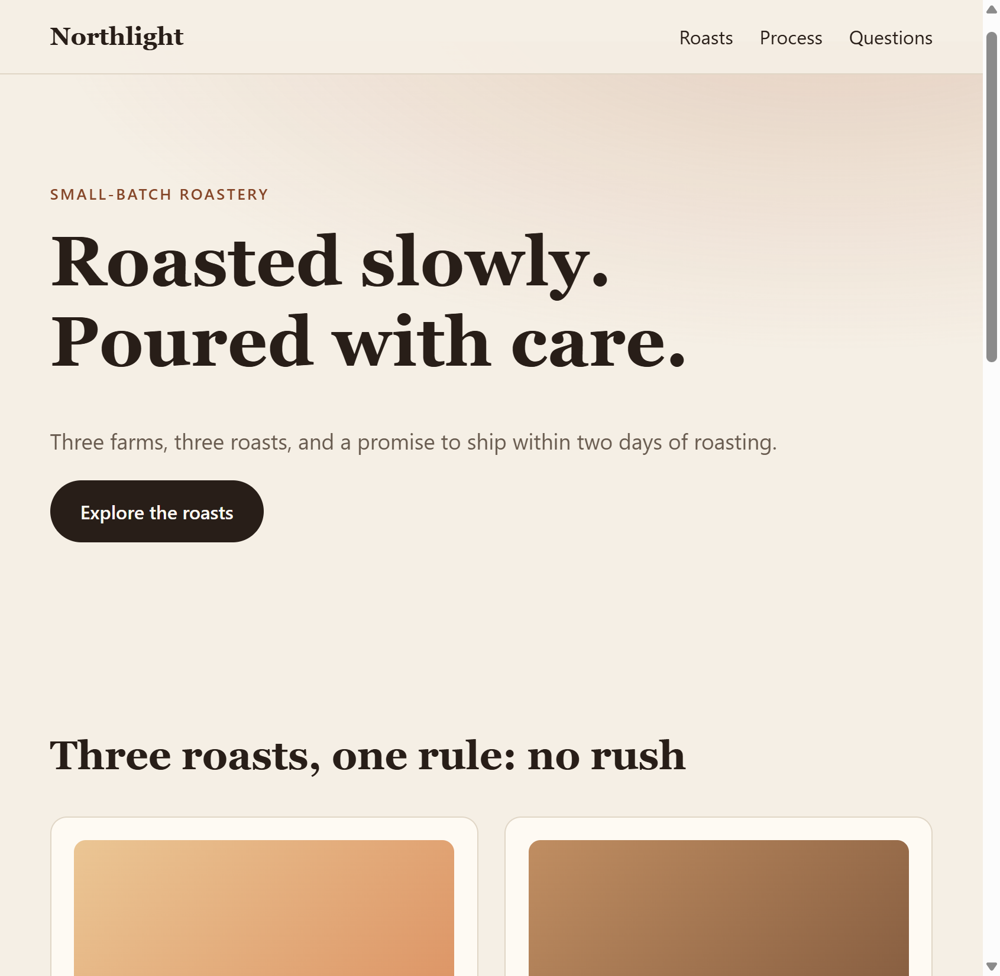

# Example: vyson-css-motion

A one-page site for Northlight Coffee, a made-up roastery. It shows the motion recipes of the [`vyson-css-motion`](../../skills/vyson-css-motion/SKILL.md) skill in use.

## Open it

Double-click `result/index.html`. It uses only plain HTML, CSS and JavaScript, with no internet connection, library or build step.

## Files

| File | What it is |
|---|---|
| [prompt.md](prompt.md) | The exact request. |
| `result/index.html`, `styles.css` | The page. |
| `result/motion-base.css` | A copy of the skill's starter file, `skills/vyson-css-motion/assets/motion-base.css`. A test checks that the two are identical. |
| `result/reveal.js`, `panel.js` | Scroll reveal (recipe 2) and FAQ panels (recipe 7). `panel.js` keeps only one panel open and supports the arrow keys. |
| `preview.png` | A screenshot of the top of the page, taken with motion allowed. **Not regenerated** after the tap-target change below; the buttons are about 1px taller now, so it differs very slightly. |
| [CREDITS.md](CREDITS.md) | Licences of everything used (nothing external). |

## Motion on this page

| Moment | Recipe | Purpose |
|---|---|---|
| Hero text and button arrive in sequence | 1 | Orient |
| Sections and cards fade up while scrolling | 2 | Orient |
| Button press, link underline, card lift | 4, 5, 6 | Feedback, personality |
| FAQ answers open smoothly, one at a time | 7 | Explain a change |

Not used on purpose: marquee, parallax and page transitions. The page does not need them.

## How it was produced, and what this proves

This page was written by an AI agent (Claude, working in Cursor) in the same session that wrote the skill. It was not hand-polished by a person. That means it shows the recipes working together, but it is **not an independent test** of whether a different agent, given only the skill and the prompt, would produce something as good. That comparison (with and without the skill, on several agents) is planned in [`bench/`](../../bench/README.md) and has not been run.

## FAQ rule and tap targets (changed after the pilot review)

- **One panel at a time.** Only one FAQ panel is expanded. Opening another closes the one that was open. Clicking the open one closes it, so zero open is allowed. Each question is a real `<button>` inside a heading, with `aria-expanded` and `aria-controls`. Closed content is `inert`, so keyboard users cannot tab into it. Arrow Up/Down, Home and End move between the questions. The panels only collapse when JavaScript is running, so without JavaScript every answer stays readable. The first panel starts open.
- **Tap targets.** On touch screens or narrow screens (`pointer: coarse` or width up to 640px) the buttons, the logo link, the nav links and the FAQ questions aim for at least 44 by 44 CSS pixels. 44px is the skill's goal; the accessibility rule it follows (WCAG 2.2, SC 2.5.8, level AA) sets 24 by 24 as the minimum, with exceptions.

## What was checked

Static checks and automated tests (run by `npm run check`; **no browser is opened**):

| Check | Result |
|---|---|
| `node skills/vyson-css-motion/scripts/motion-lint.mjs examples/vyson-css-motion/result` (14 rules) | Passed, 0 errors, 0 warnings. |
| Tests in `tools/test/` that read the example's files | Pass. They check the single-open FAQ script (against a simulated page, not a real browser), the markup and script agreement, the tap-target CSS and that `motion-base.css` matches the skill's starter file. |

Real-browser checks (**manual runs, not part of `npm run check`**):

| Check | Result |
|---|---|
| Original page, opened over a local web server in the built-in Chrome-based browser (before the changes above) | Hero entrance animations ran. 9 of 10 reveal items started hidden and all 10 became visible after scrolling. FAQ panels started closed; clicking one opened it and set `aria-expanded`. |
| Same original page with `prefers-reduced-motion: reduce` emulated | No `vy-js` class, hero animation `none`, all 10 reveal items fully visible and in place, transitions about 0.01ms, smooth scrolling off. |
| Original page, phone-sized screen (390px wide, touch emulated) | Travel distance 10px and stagger 45ms. Hover effects switched off. No sideways overflow. |
| **Updated page**, measuring script version 3 (kept in the repository under `bench/experiments/css-motion-pilot-001/harness/`), headless Chrome on one Windows 10 PC, one run | Opening two FAQ questions in turn left **1** panel open. **0 of 9** links and buttons were under 44 by 44 px at 390px wide. axe-core: 0 violations. Lint 0 errors, 0 warnings. Hover rules: 4 found, 5 tested, 5 changed, 5 animated. |

The first three rows describe the page **before** the FAQ and tap-target changes and were not repeated in full. Only the last row measures the updated page.

## What was not checked

- Frame rate or any performance measurement. Nothing was profiled.
- A real phone. Only browser emulation was used, so the real feel of the 44px targets is unknown.
- A screen reader, and a hand-done keyboard-only walkthrough. The arrow-key behaviour was tested only against a simulated page.
- The look of the hover lift and the press feedback with a real mouse or finger.
- Firefox and Safari.
- `preview.png` was not regenerated.