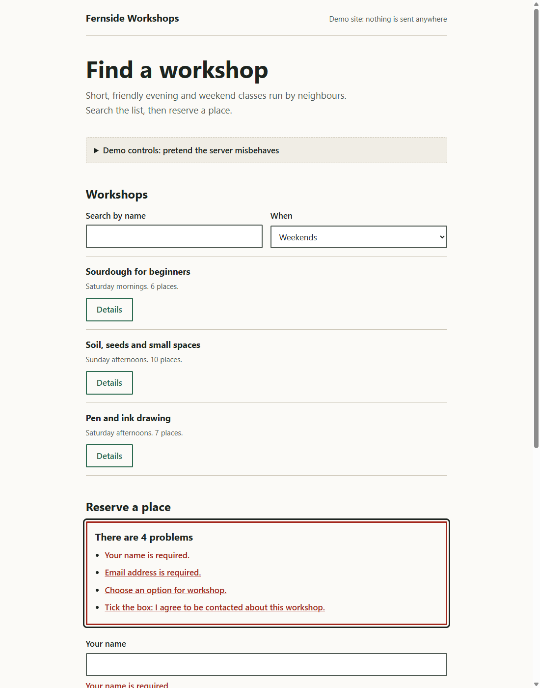

# Example: vyson-frontend-development

A one-page "find a workshop and reserve a place" site for Fernside Workshops, a made-up community programme. It shows the method of the [`vyson-frontend-development`](../../skills/vyson-frontend-development/SKILL.md) skill: HTML that works first, a searchable list with every state, a native dialog and disclosure, and an accessible form with a double-submit guard.



## Open it

Browsers do not load JavaScript modules or `fetch` a JSON file from a page opened by double-clicking it (a `file://` address). Serve the folder, then open the address it prints. Any static server that listens on your own computer works. This repository includes a small one in another skill, which you can use from the repository root:

```powershell
node skills/vyson-3d-interactive-web/scripts/serve.mjs examples/vyson-frontend-development/result
```

It listens on `127.0.0.1` only. Press `Ctrl+C` to stop it. If you open `result/index.html` directly, you still get the headings, the form and the details, but not the list or the validation helpers.

Open "Demo controls" to make the pretend server slow, empty or failing, then search again or send the form.

## Files

| File | What it is |
|---|---|
| [prompt.md](prompt.md) | The request this example answers, and what a good result looks like. |
| `result/index.html`, `styles.css` | The page. |
| `result/app.js` | Wires the page: filters, the list, the dialog, the form and the demo controls. |
| `result/fetch-state.js` | A copy of the skill's `assets/fetch-state.js`. A test checks that the two are identical. |
| `result/form-helpers.js` | A copy of the skill's `assets/form-helpers.js`. A test checks that the two are identical. |
| `result/workshops.json` | The made-up data. |
| `preview.png` | A screenshot of the page at 1100px wide, after an empty submit, taken in headless Chrome on Windows. |
| [CREDITS.md](CREDITS.md) | Licences of everything used (nothing external). |

## Decisions

| Part | Decision |
|---|---|
| Stack | Plain HTML, CSS and ES modules. A list, a dialog and one form do not need a framework or a build step. |
| Native elements | `<dialog>` for details, `<details>` for the demo controls, `<select>` and real labels everywhere. |
| Data | A local JSON file loaded with `fetchJson` (status check, timeout, cancellation). Nothing leaves the computer. |
| States | The list has loading, success, empty and error with retry, through `loadInto`. The form has invalid, submitting, success and failure. |
| Stale answers | A newer request cancels the older one, and typing is debounced by 250 ms. |
| Safe output | All DOM is built with `createElement` and `textContent`. |
| The pretend server | The "Fail" option makes the list request a file that does not exist (a real 404) and makes the sign-up throw. The "Be slow" option waits 2.5 seconds. |

## How it was produced, and what this proves

This page was written by an AI agent (Claude, working in Cursor) in the same session that wrote the skill. It was not hand-polished by a person. That means it shows the method working together, but it is **not an independent test** of whether a different agent, given only the skill and the prompt, would produce something as good. No with-and-without comparison has been run for this skill, and the eval cases in [`evals/vyson-frontend-development/`](../../evals/vyson-frontend-development/evals.json) have not been run with an agent.

The sign-up is a stand-in: no server exists, so nothing here shows how the form would behave against a real back end.

## What was checked

Static checks and automated tests (run by `npm run check`; **no browser is opened**):

| Check | Result |
|---|---|
| `node skills/vyson-frontend-development/scripts/frontend-lint.mjs examples/vyson-frontend-development/result --strict` (15 rules) | Passed, 0 errors, 0 warnings. |
| Tests of the helper modules in `tools/test/` (status checks, timeout, cancellation, error messages, stale-answer counter, validation messages, the double-submit guard) | Pass. They run the pure functions in Node with a fake `fetch`. They do not test the DOM parts. |
| Tests that read the example's files | Pass. They check the lint result, that the helper files are copies of the skill's, and the structure of the page (labels, `method="post"`, dialog, no remote files). |

Real-browser checks (**manual runs, not part of `npm run check`**), run once on 11 November 2026 in headless Chrome on one Windows 10 PC, through the DevTools protocol, with temporary scripts that are not kept in the repository, against the page served on localhost:

| Check | Result |
|---|---|
| Normal load | 6 workshops shown. No console errors or exceptions in the whole run. |
| Search for "zzz" | The empty message "No workshops match. Try another day or clear the search." |
| Filter to weekends | 3 workshops. |
| Server set to "Fail" | The error "We could not find that." with a "Try again" button. After setting the server back and pressing the button, the list returned. |
| Server set to "Be slow" | `aria-busy` was `true` and "Loading workshops..." showed during the wait. The list appeared after it. |
| A slow request replaced by a newer "empty" request | The newest result won (the empty message), not the old slow list. |
| Details dialog | It opened with the right title, focus was inside it, `Escape` closed it. (The test clicked with a script, so focus return to the opener was not exercised.) |
| Empty form submit | An error summary with 4 problems took focus. Four fields got `aria-invalid="true"` and an `aria-describedby` pointing at an inline message. |
| An invalid email, then a valid one | The message "Enter an email address like name@example.com." appeared, then cleared as the value was fixed. |
| Three clicks on "Reserve" during one submit | The submit handler ran once. The form had `data-busy`, and the button `aria-disabled="true"`. The status then read "Thanks. This is a demo, so nothing was sent." |
| Failing sign-up | The status read "We could not reserve that place. Please try again." |
| Phone width (390, touch emulation) | No sideways scrolling. Every button, link, input and summary was at least 44 by 44 CSS pixels except the consent checkbox itself (24 by 24, the minimum allowed). Its label, which toggles it, is 44 pixels high. |

## What was not checked

- A real phone, Firefox, Safari, and any operating system other than Windows 10.
- A screen reader. The roles and attributes were checked in the page, but nothing was listened to.
- A hand-done keyboard-only walkthrough by a person. The checks above used scripted events.
- Focus returning to the "Details" button after the dialog closes when it is opened by a real click or keypress.
- Real server behaviour: authentication, validation on the server, rate limits and the real `POST` of the form.
- The page with JavaScript disabled, beyond reading the markup.
- Real 200 percent browser zoom and a changed browser text-size setting.
- Performance. Nothing was measured.
