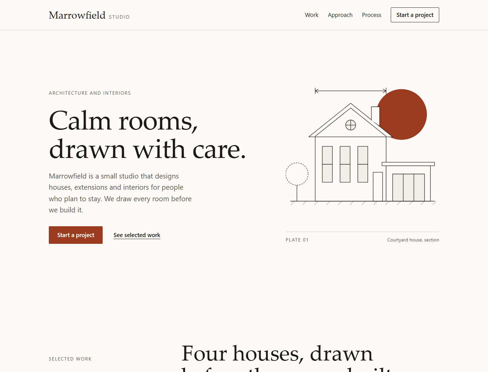

# Example: vyson-premium-website-design

A one-page site for Marrowfield Studio, a made-up architecture and interiors studio. It shows the method of the [`vyson-premium-website-design`](../../skills/vyson-premium-website-design/SKILL.md) skill: a decided direction, a token system, varied section layouts, real copy and finished details.

## Open it

Double-click `result/index.html`. It uses only plain HTML and CSS, with no internet connection, library, script or build step.

## Files

| File | What it is |
|---|---|
| [prompt.md](prompt.md) | The request this example answers, and what a good result looks like. |
| `result/index.html`, `styles.css` | The page. |
| `result/design-tokens.css` | A copy of the skill's starter file, `skills/vyson-premium-website-design/assets/design-tokens.css`. A test checks that the two are identical. |
| `preview.png` | A screenshot of the top of the page at 1440px wide, taken in Chrome on Windows. |
| [CREDITS.md](CREDITS.md) | Licences of everything used (nothing external). |

## The direction note for this page

| Line | Decision |
|---|---|
| Audience | People planning a house or an extension, reading on a phone or a laptop |
| Job of the page | Start a project (email the studio) |
| Feels like | Quiet, exact, warm |
| Must not feel like | Corporate, flashy, cold |
| Direction type | Editorial |
| Signature move | Large serif headings, thin architectural line drawings and one terracotta circle (the drawing, the numerals and the buttons share the accent) |
| Type | System serif stack for headings, system sans stack for text |
| Colour | Warm off-white, near-black, one terracotta accent used for action and numerals |
| Layout stance | Asymmetric two-column splits, an index list instead of a card grid, one dark band, a four-step process |
| Imagery | One original SVG drawing. No photographs. |

Not used on purpose: stock photos, a testimonial carousel, a row of equal icon cards, gradients, and all animation. Motion belongs to the `vyson-css-motion` skill.

## How it was produced, and what this proves

This page was written by an AI agent (Claude, working in Cursor) in the same session that wrote the skill. It was not hand-polished by a person. That means it shows the method working together, but it is **not an independent test** of whether a different agent, given only the skill and the prompt, would produce something as good. No with-and-without comparison has been run for this skill, and the eval cases in [`evals/vyson-premium-website-design/`](../../evals/vyson-premium-website-design/evals.json) have not been run with an agent.

Whether the page looks "premium" is a judgement, and the design is the author's opinion. Nothing here proves it persuades visitors or converts better.

## What was checked

Static checks and automated tests (run by `npm run check`; **no browser is opened**):

| Check | Result |
|---|---|
| `node skills/vyson-premium-website-design/scripts/design-lint.mjs examples/vyson-premium-website-design/result --strict` (18 rules) | Passed, 0 errors, 0 warnings. |
| `node skills/vyson-css-motion/scripts/motion-lint.mjs examples/vyson-premium-website-design/result --strict` (confirms the page adds no unsafe motion) | Passed, 0 errors, 0 warnings. |
| Tests in `tools/test/` that read the example's files | Pass. They check that the example is lint-clean, that its token file matches the skill's starter file, and that its HTML has one `h1`, a skip link, labelled landmarks and no external files. |

Real-browser checks (**manual runs, not part of `npm run check`**), run once on 11 November 2026 in headless Chrome on one Windows 10 PC, through the DevTools protocol, with temporary scripts that are not kept in the repository:

| Check | Result |
|---|---|
| Page widths 320, 360, 390 (touch emulation), 720, 1024, 1440 and 1920 | No sideways scrolling at any of them. |
| Size of every visible link and button at those widths | 0 of 8 (at 320 to 390px) and 0 of 9 (at 720px and wider) were under 44 by 44 CSS pixels. At phone widths the header action is hidden because the hero repeats it. |
| Keyboard: real `Tab` key presses at 1440px | The skip link comes first, then the links and buttons in page order. Each showed a solid 3px outline with a 3px offset. Focus then returned to the skip link. |
| Body text size and `h1` count | 17px, and exactly one `h1`. |
| Screenshots of the whole page at 390 and 1440px, looked at by the author | The layout matches the direction note. No overlap or cut-off text was seen. |

Looking at the screenshots is a design review by the same agent that built the page, not an independent review.

## What was not checked

- A real phone. Only browser emulation of a phone-sized screen was used.
- Firefox and Safari, and any operating system other than Windows 10. The serif stack starts with fonts that exist on Windows and Apple systems (`Palatino Linotype`, `Iowan Old Style`), so the headings will look different elsewhere.
- Real browser zoom to 200 percent, and a changed browser text-size setting. Narrow viewports of 360 and 720px were used as a rough stand-in.
- A screen reader, and a hand-done keyboard-only walkthrough by a person.
- Contrast of text on every combination by an independent tool. The skill's own checker verified the token pairs, and the dark band colours were computed by hand (10.2:1 for text and 8.1:1 for the accent numerals on the band colour).
- Frame rate, load time or any other performance measurement. Nothing was profiled.
- Print layout, and a slow network.
