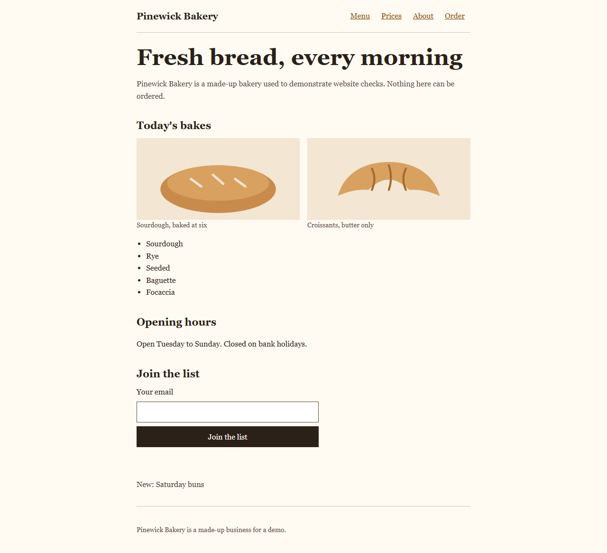
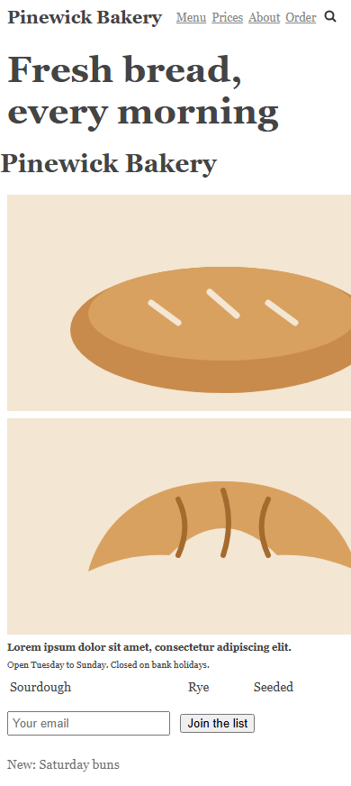
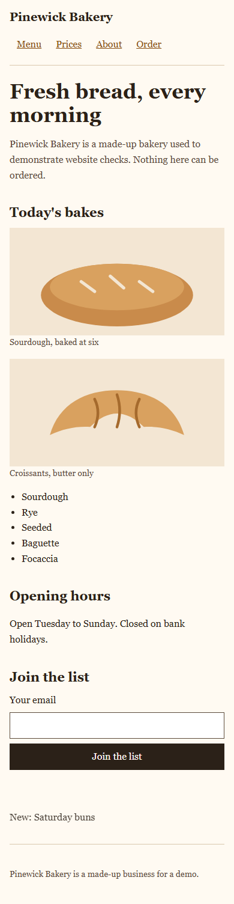

# Example: vyson-website-quality-engineering

A small, made-up bakery site in two versions: `site-before/` has launch problems on purpose, and `site-after/` is the repaired version. It shows the method of the [`vyson-website-quality-engineering`](../../skills/vyson-website-quality-engineering/SKILL.md) skill: run the static audit and the browser check, fix what they find, run them again, and report what was and was not tested.



On a phone-sized screen (390 wide), before and after:

| Before | After |
|---|---|
|  |  |

## Try it

```powershell
node skills/vyson-website-quality-engineering/scripts/site-audit.mjs examples/vyson-website-quality-engineering/site-before
node skills/vyson-website-quality-engineering/scripts/browser-check.mjs examples/vyson-website-quality-engineering/site-before
node skills/vyson-website-quality-engineering/scripts/site-audit.mjs examples/vyson-website-quality-engineering/site-after
node skills/vyson-website-quality-engineering/scripts/browser-check.mjs examples/vyson-website-quality-engineering/site-after
```

The browser check needs Chrome or Edge on your computer. It serves the folder on `127.0.0.1` only.

Both tools exit with 1 on `site-before/`. That is the expected outcome, not a broken example.

## Files

| File | What it is |
|---|---|
| [prompt.md](prompt.md) | The request this example answers, and what a good result looks like. |
| `site-before/` | The flawed site: 2 pages, a stylesheet, a script and two drawings. |
| `site-after/` | The repaired site: 3 pages (an About page was added so a link works). |
| [REPORT.md](REPORT.md) | The launch report in the skill's format, filled in from the real tool output. |
| `audit-before.txt`, `audit-after.txt` | Unedited output of `site-audit.mjs` on the two folders. |
| `browser-before.txt`, `browser-after.txt` | Unedited output of `browser-check.mjs` on the two folders (home page, five widths). |
| `preview.png`, `before-390.png`, `after-390.png` | Screenshots taken by `browser-check.mjs --screenshots`. |
| [CREDITS.md](CREDITS.md) | Licences of everything used (nothing external). |

## Results

| Tool | Before | After |
|---|---|---|
| `site-audit.mjs` (static) | `FAILED. 10 errors, 24 warnings.` | `PASSED. 0 errors, 0 warnings.` |
| `browser-check.mjs` (headless Chrome 157, Windows 10, one run) | `FAILED. 12 errors, 13 warnings.` | `PASSED. 0 errors, 0 warnings.` |

The browser test found problems the static audit cannot see: sideways scrolling on phone widths, tiny tap targets, invisible keyboard focus and animation that ignores reduced motion.

## How it was produced, and what this proves

The flawed site was written on purpose by an AI agent (Claude, working in Cursor) in the same session that wrote the skill and its two tools. The problems in it were chosen to match the tools' rules, and the fixed site was written by the same agent. So this example shows that the tools find real, visible problems and that the fixes clear them. It is **not an independent test**: it does not show that the tools find every problem, nor that a different agent, given only the skill and the prompt, would produce a good report. No with-and-without comparison has been run, and the cases in [`evals/vyson-website-quality-engineering/`](../../evals/vyson-website-quality-engineering/evals.json) have not been run with an agent.

The tools were also run on the other four examples in this repository on 11 November 2026 (headless Chrome, widths 390 and 1280 for three of them). They found no errors, which is not proof that those pages have none.

## What was checked

Static checks and automated tests (run by `npm run check`; **no browser is opened**):

| Check | Result |
|---|---|
| Tests in `tools/test/` that audit `site-before/` and `site-after/` | Pass. They expect errors in the first folder and none in the second, and check that the saved output files list the same rule codes the tool reports now. |

Browser tests (**manual runs, not part of `npm run check`**), run once on 11 November 2026 in headless Chrome 157 on one Windows 10 PC. The results are in `browser-before.txt` and `browser-after.txt`. The automated tests include one browser run that is skipped when no Chrome or Edge is found.

## What was not checked

- A real phone, Firefox, Safari, and any operating system other than Windows 10.
- A screen reader, a hand-done keyboard walkthrough by a person, colour contrast, and 200 percent zoom.
- `menu.html` and `about.html` in the browser test (only `index.html` was opened).
- Field data, a slow network, and server settings such as compression and caching (there is no server).
- Whether the tools find problems in sites unlike this one. They have been run on five small hand-written sites only.
